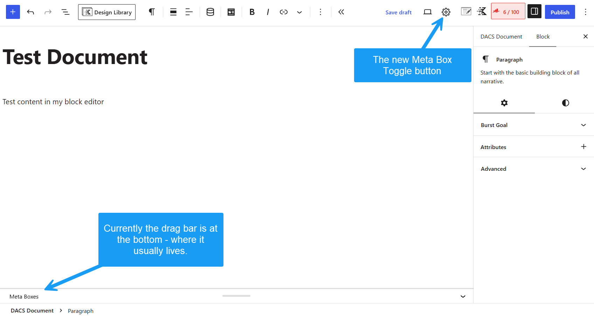
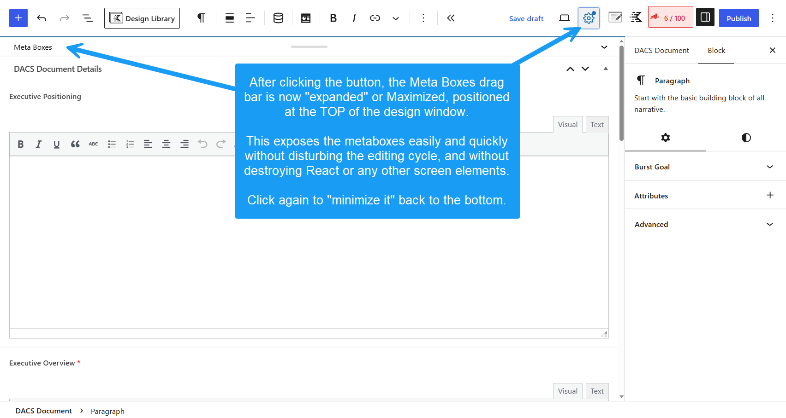

# Block Meta Toggle for WP (`block-meta-toggle-wp`)

A lightweight, highly durable WordPress utility that adds an **Inline Height Toggle** to the Block Editor toolbar. It minimizes the footer meta box container (ACF, Rank Math, Yoast, and custom metaboxes) down to a clean 32px bar and lets you expand it into a full-height editing viewport with a single click.  It will work for ANY meta boxes found at the "bottom" of your content editor.

Unlike other solutions that physically detach or move DOM elements into React modal portals—breaking event listeners and virtual DOM states—**Block Meta Toggle for WP** operates purely through native CSS and JavaScript height manipulation directly within the WordPress canvas flow.

---

## Screenshots

*Figure 1: Gear icon toggle injected into the top toolbar.*

*Figure 2: Expanded full-height meta box viewport.*

---

## Key Features

* **Zero DOM Relocation:** Keeps `#poststuff` and all meta fields in their native DOM location. Fully preserves ACF repeater fields, Select2 dropdowns, color pickers, and third-party JS listeners.
* **100% Core Save Compatible:** No hijacked submission handlers or broken auto-save states. Standard WordPress Update/Publish buttons handle all data seamlessly.
* **Inline Canvas Viewport:** Expands native meta boxes smoothly over the content editor while maintaining full visibility of top toolbars, left admin menus, and right sidebars.
* **Auto-Expand Collapsed Panels:** Automatically uncollapses hidden or aria-collapsed field liners when maximized.
* **Lightweight & Clean:** Single-file architecture with zero database settings or admin clutter.

---

## Installation

### As a Standard Plugin
1. Download or clone this repository.
2. Upload the `block-meta-toggle-wp` directory to your site's `/wp-content/plugins/` folder.
3. Activate **Block Meta Toggle for WP** via **Plugins > Installed Plugins** in the WordPress admin dashboard.

### As an MU-Plugin (Recommended for Agencies)
Drop `block-meta-toggle-wp.php` directly into `/wp-content/mu-plugins/`. It will activate automatically across all post types in the Block Editor without cluttering the main plugins list.

---

## How It Works

1. On Block Editor load, the plugin injects a **Gear Icon** (`#acf-meta-toggle-btn`) into the top header settings bar.
2. By default, the native `.edit-post-meta-boxes-main` container is locked to a clean 32px minimized bar at the bottom of the screen.
3. Clicking **Toggle Meta** expands the container to fill the visible editor height (`calc(100vh - 120px)`) and smoothly scrolls it into view.
4. Clicking **Toggle Meta** again minimizes the panel back to 32px and returns scroll focus smoothly to the main content canvas.

---

## Requirements

* **WordPress:** 5.8+ (Block Editor)
* **PHP:** 7.4 or higher
* Compatible with Advanced Custom Fields (ACF), Rank Math, Yoast, and custom `add_meta_box()` calls.

---

## License

GPL-2.0-or-later — Free for personal and commercial use.
